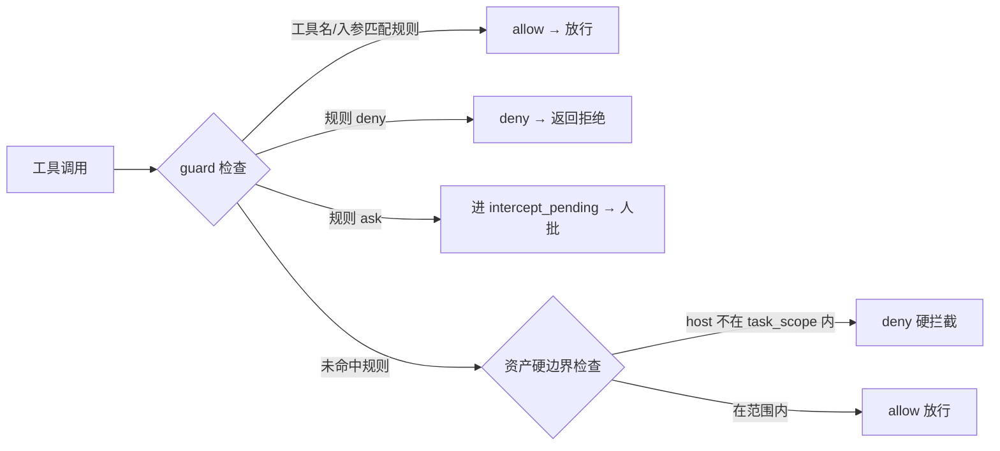

# AI 渗透测试系统 · MVP 规划文档

> 目标：复刻 PENTIGENT 的核心架构（双图 + planner/worker 事件驱动闭环），
> 做出一套**能自己跑起来**的 MVP 骨架，后续再迭代功能。
> 技术栈照搬：Go + Next.js + PostgreSQL；LLM 接入 OpenAI 兼容接口。

---

## 1. 项目定位

一句话：**给一个任务目标和描述，系统自己决定"先干什么、再干什么"，
用真实工具探测目标资产，把发现写回数据库，直到证明目标达成。**

- 不是聊天机器人：agent 真实执行 bash / HTTP 请求
- 不是全自动黑盒：危险动作走审批门，人在环路可插话
- 每次执行全程留痕：activity 账本 + 工具调用记录

---

## 2. 技术栈

| 层 | 选型 | 说明 |
|---|---|---|
| 后端 | Go 1.26 | 单体，单二进制 |
| 前端 | Next.js 16 (React 19) | 静态导出后 go:embed 内嵌 |
| 数据库 | PostgreSQL 16 | 双图 + 任务 + 活动全部落 PG |
| LLM | OpenAI 兼容接口 | 官方 / DeepSeek / 通义 / Kimi 通用 |
| 审批 | 内置规则引擎 | 先 allow/deny 规则，后续加 LLM 兜底 |

**明确不做（MVP 阶段）**：任务级 token 预算、多供应商 failover pool、
流量 MITM 留痕代理、漏洞 IM 推送、自更新、ScopeSentry 同步、冷归档。

---

## 3. 总体架构

```
┌─────────────── 前端 Next.js（go:embed 内嵌） ───────────────┐
│  任务列表 · 任务详情(会话/工具调用/探索图) · 发现 · 资产 · 审批    │
└──────────────────────────┬──────────────────────────────────┘
                           │ HTTP (REST /api/*) + SSE 活动流
┌──────────────────────────▼──────────────────────────────────┐
│  server（Go net/http）                                        │
│   · Manager：任务/引擎/store 生命周期                          │
│   · Engine：事件驱动调度循环（planner + N worker）              │
│   · guard：工具审批门                                          │
└──────────────────────────┬──────────────────────────────────┘
                           │
┌──────────────────────────▼──────────────────────────────────┐
│  agent（LLM agent）                                          │
│   · goals 目标分解 + 约束提取                                  │
│   · planner 规划者（唯一意图生成者）                            │
│   · worker 执行者 ×N（领一条意图 → 执行 → 写回 → 停）           │
└──────────────────────────┬──────────────────────────────────┘
                           │
┌──────────────────────────▼──────────────────────────────────┐
│  db（pgx → PostgreSQL）                                       │
│   · 资产图：companies / assets / company_scope                │
│   · 探索图：explorations / nodes / edges / anchors / activity │
│   · 任务层：tasks / task_scope / findings / intercept         │
└──────────────────────────────────────────────────────────────┘
```

---

## 4. 核心设计：双图架构（照搬 PENTIGENT）

### 4.1 资产图（全局共享 · 真值库）

跨任务同一份，节点 6 种类型，归属公司：

```
root_domain → subdomain → service → endpoint
      └──→ ip
```

- 父子关系与去重 key **全部由程序计算**，agent 只提交原始信息
- 每个类型有唯一索引去重（domain / ip / app_name / url+method...）

### 4.2 探索图（每任务独立 · 推进链）

一次任务"思考与推进"的过程，节点 6 种：

| 节点 | 含义 | 状态机 |
|---|---|---|
| goal | 目标 | open → met / abandoned |
| intent | 意图（一条可执行方向） | open → running → done / blocked / exhausted |
| fact | 事实（探测结论） | confirmed / dismissed |
| finding | 漏洞 | confirmed / dismissed |
| hint | 提示 | active / consumed |
| digest | 冷节点折叠（先不做） | - |

边关系：`spawns / derived_from / yields / proves`

### 4.3 锚点：两图相连

`exploration_anchors(node_id, asset_id)`：
- 从"探索方向"看它打了哪些资产
- 从"某个资产"反查被哪些意图测过
- 支撑资产测试覆盖度（MVP 先只存数据，不做覆盖图）

---

## 5. 引擎闭环（最关键机制）

```
图变更 → debounce(500ms) → 唤醒 planner
  → planner 读探索图态势 + 共享 todolist
  → 判断目标是否已达成（prove_goal）
  → 只对"有新方向"派 0..N 条 intent 进 frontier（多数唤醒派 0 条 = 结束）
  → N 个 worker goroutine 并发 claimNext 领一条 intent
  → 真实工具执行（bash/HTTP，先过 guard 审批门）
  → 写回 fact / asset / finding + 每步 activity
  → 再次触发图变更 → 闭环
```

两个关键设计（照搬，确保攻击链稳定推进）：

1. **planner 跨唤醒共享 todolist**
   - 每次唤醒是全新 LLM 会话，但 todolist 按任务常驻
   - 串行利用链（发现注入点→取凭据→横向→提权）记一次，分多轮按依赖逐步派

2. **worker 间过程级信息交换**
   - activity 表 = 过程库
   - `search_all_worker_traces(q)` 搜其他 worker 执行过程的观察
   - `get_worker_trace(intent_id, step_ids)` 取完整过程

---

## 6. 数据库 Schema 规划

照搬 PENTIGENT 的幂等 schema 风格：全部 `IF NOT EXISTS`，启动时重跑 = "重启即迁移"。

### 表清单

| 分组 | 表 | 用途 |
|---|---|---|
| A 资产层 | companies | 公司实体 |
| | assets | 6 类资产节点 + 唯一去重索引 |
| | company_scope | 公司资产范围 |
| B 探索层 | explorations | 一次任务的一次探索 |
| | exploration_nodes | goal/intent/fact/finding/hint 节点 |
| | exploration_edges | spawns/derived_from/yields/proves |
| | exploration_anchors | 节点↔资产锚点 |
| | activity | 每步执行账本（含 token 统计） |
| | task_constraints | 操作员 allow/deny 约束 |
| C 配置 | settings | 键值设置 |
| | llm_profiles | LLM 配置（MVP 只做 1 条 openai） |
| D 任务层 | tasks | 任务（goal/description/status） |
| | task_scope | 授权边界 = 覆盖度分母 |
| | task_categories | 任务分类 |
| E Agent | agents | planner/worker/main 角色定义+提示词 |
| | agent_prompts | 可编辑提示词模板（版本化） |
| F 发现 | findings | 漏洞（含 status/severity/evidence） |
| G 审批 | intercept_rules | 工具调用规则（allow/deny/ask） |
| | intercept_pending | 待审批队列 |
| | asset_intercept_rules | 目标资产黑名单（硬边界） |

### 关键去重索引（资产图）

```sql
root_domain: UNIQUE(domain) WHERE type='root_domain'
ip:          UNIQUE(ip)     WHERE type='ip'
subdomain:   UNIQUE(domain, record_type)
app:         UNIQUE(bundle_id) / UNIQUE(app_name)
service:     UNIQUE(url) WHERE type='service'
endpoint:    UNIQUE(url, method)
```

---

## 7. 目录结构规划

```
PENTIGENT-mvp/
├── cmd/PENTIGENT/main.go        # 入口：HTTP 监听 + 信号处理
├── config/config.go         # config.json 解析（仅 database + skill_dir）
├── db/
│   ├── schema.sql           # 幂等建表（go:embed）
│   ├── db.go                # pgx pool + schema 执行
│   ├── assets.go            # 资产图 store
│   ├── exploration.go       # 探索图 store
│   ├── tasks.go             # 任务/范围 store
│   └── findings.go          # 漏洞 store
├── agent/
│   ├── provider.go          # Provider 接口 + OpenAI 兼容实现
│   ├── goals.go             # 目标分解 + 约束提取
│   ├── planner.go           # 规划者（唯一意图生成者 + todolist）
│   ├── worker.go            # 执行者（领意图→工具→写回）
│   └── tools.go             # 双图暴露成 LLM 工具
├── server/
│   ├── server.go            # HTTP 路由 + JWT + SSE
│   ├── manager.go           # 任务/引擎生命周期
│   ├── engine.go            # 事件驱动闭环
│   └── guard.go             # 审批门
├── intercept/               # 规则匹配 + 待审队列
└── web/                     # Next.js 前端（静态导出）
    └── src/app/             # 任务列表/详情/资产/发现
```

---

## 8. LLM 接入（OpenAI 兼容）

MVP 只做一个实现，不做 failover pool：

```go
type Provider interface {
    Chat(ctx context.Context, req ChatRequest) (ChatResponse, error) // 流式
}

type ChatRequest struct {
    Model       string
    Messages    []Message       // system/user/assistant + tool_result
    Tools       []Tool          // function calling schema
    MaxTokens   int
    Temperature float64
}

// 非流式先跑通，流式后续加
```

- 配置走环境变量：`OPENAI_API_KEY` / `OPENAI_BASE_URL` / `OPENAI_MODEL`
- **mock 模式**：无 key 时用内置假 LLM 返回固定函数调用，跑通整条闭环
- 每步 LLM 调用记录进 `activity`（input/output tokens）

---

## 9. LLM 工具集（ToolSet）

| 工具 | 归属 | 作用 |
|---|---|---|
| set_goals | goals | 提交分解后的目标节点 |
| add_task_scope | goals | 登记授权边界 |
| set_constraints | goals | 登记 allow/deny 约束 |
| add_intent | planner | 派意图进 frontier（唯一生成者） |
| prove_goal | planner | 声明目标已达成 |
| claim_intent | engine | worker 领一条意图（引擎侧，非 LLM 工具） |
| insert_assets | worker | 提交发现的资产（程序算父子/去重） |
| record_fact | worker | 写事实节点 |
| report_finding | worker | 写漏洞节点 |
| bash | worker | 执行命令（过 guard 审批） |
| webfetch | worker | HTTP 请求（过 guard + 留痕） |
| search_all_worker_traces | worker | 搜其他 worker 执行过程 |
| get_worker_trace | worker | 取某 work 具体步骤完整内容 |

---

## 10. 审批门（guard / intercept）



- 规则：`match_target=tool_name/tool_input` × `match_type=string/regex`
- **资产硬边界**：bash/webfetch 参数里解析出的 host/url 不在任务范围内 → 直接 deny，不走 LLM（代码硬判，不依赖提示词）

---

## 11. API 规划

```
POST   /api/auth/setup          # 首次设置管理员密码
POST   /api/auth/login          # JWT 登录
GET    /api/tasks               # 任务列表（含 token 消耗/发现数）
POST   /api/tasks               # 创建任务（goal+description+scope）
GET    /api/tasks/:id           # 任务详情
POST   /api/tasks/:id/start     # 启动
POST   /api/tasks/:id/pause     # 暂停
POST   /api/tasks/:id/stop      # 停止
DELETE /api/tasks/:id           # 删除（级联清理）
GET    /api/tasks/:id/events    # SSE 活动流
GET    /api/tasks/:id/graph     # 探索图数据
GET    /api/assets              # 资产图（按类型/公司过滤）
GET    /api/findings            # 漏洞列表
GET    /api/intercept/pending   # 待审批队列
POST   /api/intercept/:id/decision  # allow/deny
GET    /api/health              # 健康检查（版本/LLM 状态）
```

---

## 12. 前端页面规划（最小集）

| 页面 | 路由 | 内容 |
|---|---|---|
| 登录/设置 | /setup, /login | 首次管理员密码 + 登录 |
| 仪表盘 | / | 任务列表 + 运行状态 + token 消耗 |
| 任务详情 | /tasks/:id | 目标/描述 · 状态 · 探索图 · 活动流(SSE) |
| 资产 | /assets | 资产图列表（类型/公司过滤） |
| 发现 | /findings | 漏洞列表（severity/status 过滤） |
| 审批 | /intercept | 待审批队列 + allow/deny |

技术：Next.js 静态导出 + shadcn/ui + zustand；图可视化用 @antv/g6（后期）。

---

## 13. 开发里程碑

| 阶段 | 内容 | 验收标准 |
|---|---|---|
| M0 环境 | 装 Go + PG + 初始化仓库 | `go build ./...` 通过 |
| M1 数据层 | schema.sql + db 包全绿 | `go test ./db/...` 通过 |
| M2 LLM 层 | provider 接口 + OpenAI 实现 + mock | 命令行能对话 |
| M3 agent | goals/planner/worker + 工具集 | 单测覆盖函数调用解析 |
| M4 引擎 | 事件驱动闭环 + 审批门 | **e2e：mock LLM 跑通全闭环** |
| M5 API | REST + JWT + SSE | curl 可创建/启动/看活动流 |
| M6 前端 | 任务列表/详情/活动流 | 浏览器看到 agent 干活过程 |
| M7 打磨 | 探索图可视化 + 发现页 | 一个假目标完整跑一遍 |

---

## 14. 与 PENTIGENT 的差异（有意简化）

| 维度 | PENTIGENT | 本 MVP |
|---|---|---|
| 状态并发 | 多 goroutine + 大量 sync.Map | 单 goroutine actor / 简单锁 |
| LLM 接入 | 双格式 + failover pool + 熔断 | 一个 interface + OpenAI 实现 |
| 上下文 | 每轮全量图 + 复杂压缩 | 增量 delta + 固定窗口 |
| 支撑系统 | 流量代理/通知/自更新/归档 | 全部后置，MVP 不做 |
| token 预算 | 无 | 不做（用户确认） |

---

## 15. 风险与对策

| 风险 | 对策 |
|---|---|
| LLM 调用烧钱 | 规则化预判（frontier 空就不调）+ 上下文固定窗口 |
| agent 跑偏/死循环 | 任务超时收尾 + worker 单意图边界 + 审批门兜底 |
| 资产数据脏 | 唯一索引去重 + 程序算父子关系 + 入库前校验 |
| PG 不可用 | M0 先降级 SQLite 跑通，PG 环境就绪后换连接串 |
| 无 LLM key | mock provider 先跑通全流程，配 key 即切真实 |
